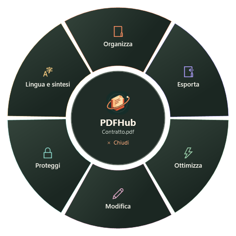

# PDFHub Desktop

Apri **Installa icona desktop.cmd** per creare il collegamento nella cartella Desktop configurata in Windows. Nella cartella del progetto trovi anche **PDFHub Desktop.lnk**, pronto per questo PC.

**Trascina uno o più file sull’icona.** Si apre una ruota vettoriale trasparente vicino al puntatore, sul monitor in uso. Scegli una categoria e poi uno strumento. Puoi aggiungere, riordinare o rimuovere file prima di premere **Esegui e salva**. Chiudendo l’editor torni alla ruota. Il centro e il tasto Esc permettono di tornare indietro.

**Con il doppio clic** si apre lo Studio per il caricamento manuale, la ricerca degli strumenti e il recupero dei risultati della sessione. Se Edge e Chrome non riescono a visualizzare lo Studio, PDFHub apre la ruota nativa. In questo caso il centro offre **Scegli file** e puoi anche selezionare prima lo strumento. **Scansiona** è disponibile partendo senza file.

## Strumenti

La selezione delle categorie prende come riferimento il [catalogo pubblico di iLovePDF](https://www.ilovepdf.com/).

| Categoria | Operazioni |
| --- | --- |
| Organizza | Unione, divisione per pagina o intervallo, estrazione, eliminazione, riordino, rotazione, acquisizione da scanner WIA |
| Converti in PDF | Immagini JPG, PNG, BMP e TIFF, documenti DOCX, cartelle XLSX, presentazioni PPTX, HTML e testo UTF-8 |
| Esporta | Pagine in JPG o PNG, Word, tabelle in Excel, diapositive PowerPoint, testo, Markdown, immagini incorporate |
| Ottimizza | Compressione in due livelli, riparazione dei PDF recuperabili, OCR di Windows, copia visiva PDF/A-2b |
| Modifica | Numerazione, filigrana, ritaglio, inserimento di testo, firma visiva con nome digitato, compilazione e creazione di campi testuali |
| Proteggi | Cifratura AES-256, rimozione della password conosciuta, oscuramento delle occorrenze testuali sulle pagine, confronto testuale tra due PDF |
| Lingua e sintesi | Riassunto per frasi principali, riassunto con modello locale, traduzione in un nuovo PDF con modello locale |

## Formati e componenti

Il limite è di 200 MB complessivi per operazione. I risultati dello Studio sono disponibili fino alla chiusura. L’editor nativo prepara il risultato in una cartella temporanea e lo salva nella destinazione scelta. Le conversioni avvengono sul computer.

Per i documenti Office PDFHub prova l’esportazione dell’applicazione installata. Se Office non può eseguirla, il motore locale ricompone il contenuto e identifica il risultato con il suffisso **-contenuto.pdf**. L’impaginazione può cambiare. Le esportazioni da PDF a PowerPoint usano un’immagine per diapositiva. Il profilo di archiviazione PDF/A rasterizza le pagine e incorpora il profilo sRGB di Windows.

L’OCR elabora le pagine prive di testo e richiede il riconoscimento ottico installato per una lingua di Windows. Lo scanner usa il driver WIA. Il riassunto per frasi principali funziona da solo. Per traduzione e sintesi con modello serve Ollama in esecuzione sul PC con un modello già scaricato. La traduzione conserva il testo in una nuova impaginazione. Il confronto e l’oscuramento cercano testo selezionabile. La firma aggiunge un segno visivo al documento.

## Su un altro PC Windows

Mantieni insieme i file del progetto. Servono Python 3.12 con `python.exe` e `pythonw.exe` nel PATH e .NET Framework 4.8. Installa le dipendenze con `python -m pip install -r requirements.txt`. Esegui **Installa icona desktop.cmd** dalla nuova cartella. Edge o Chrome abilitano lo Studio con cronologia della sessione.

Per ricompilare l’eseguibile e rigenerare l’icona usa `python build.py`. Il rapporto [Verifiche](VERIFICHE.md) contiene gli esiti e i comandi delle prove.
